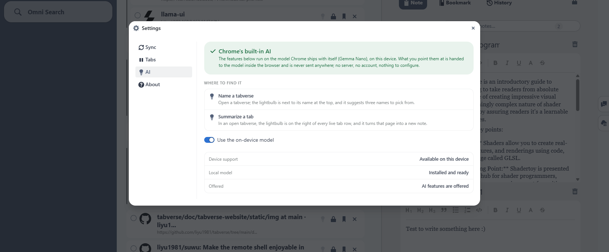
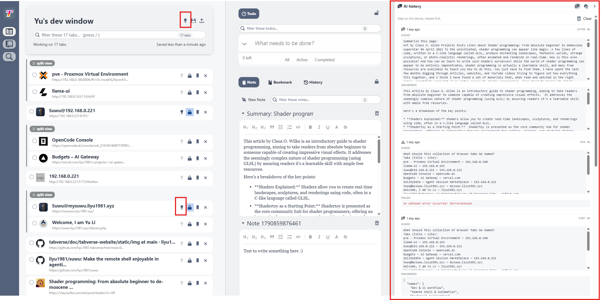

# On-device AI

Where Chrome ships its built-in language model (**Gemma Nano**), Tabverse uses
it, entirely on this device, for:

- **AI Chat** - a conversation in a tool tab, which can answer about a page you
  attach to a question.
- **Summarize a page into a note** - a new note, or appended to the note you are
  editing.
- **Suggest a name** for the current tab collection, from its tabs' titles and
  hosts.

One page action, **View page content as Markdown**, needs no model at all: it
converts the page to Markdown and shows it, ready to copy.

## Where to find it

**Settings ▸ AI** reports three things: whether this device can use the model at
all, whether it is switched on (*Use the on-device model*), and whether the
local model is installed. Chrome downloads the model once, on first use.

In the manager, the AI controls are the lightbulbs and the **AI Chat** tool tab:

- **Name a tabverse** - the lightbulb next to the tabverse's name.
- **Page actions** - the lightbulb on a live tab row (see below).
- **AI Chat** - a tool tab beside Todo, Note, Bookmark and History (see below).

Without Chrome's built-in model the AI items are disabled and the chat says so;
**Settings ▸ AI** says why. The page-actions menu still works - **View page
content as Markdown** needs no model.

## Page actions on a live tab

The lightbulb on a live tab row opens a menu. The button is disabled while the
tab is suspended, because a discarded tab has no page to read.

- **View page content as Markdown** - reads the page, isolates its article and
  converts it to Markdown, then shows it in a dialog with a **Copy Markdown**
  button. No model is needed.
- **Send page content to AI chat** - attaches the page to the next question in
  the AI Chat tool and opens that tool (see below).
- **New note with AI summary** - summarizes the page and adds the summary as a
  new note in the current tabverse.
- **Append to current note with AI summary** - the same summary, proposed to the
  note you are editing; nothing is written until you review and accept it.

The summary is built from the page's **Markdown**, not from its raw text, so the
model reads the article rather than the page furniture (navigation, footers,
cookie banners).

## AI Chat

**AI Chat** is a conversation with the same on-device model. It is a
[tool](../basic-usage/tabverses#tools) in the tools column, beside Todo, Note,
Bookmark and History, so it can be pinned and focused like the rest. The
conversation is one chat for the extension, kept on this device, and is separate
from the AI history.

- **Ask** in the box at the bottom. **Enter** sends; **Shift+Enter** starts a new
  line. The answer streams in and is drawn as Markdown (headings, lists, code).
- **Copy** an answer, or **Regenerate** the newest one.
- The **Context** bar at the top of the chat shows how much of the model's
  context window the conversation is using.
- **Clear conversation** (in that top bar) throws the whole conversation away.
  **Clear input** (in the composer) clears only the draft and any attached page.
- When the conversation is long enough to fill the context window, the older
  turns are folded into one summary, shown in the transcript as *Earlier
  conversation summarized to fit the context*.

## Attach a page to a question

**Send page content to AI chat** on a live tab attaches that page to the next
question:

- the page appears as a **chip** above the composer; remove it with its **×**
  or clear it with **Clear input**;
- type your question and send. The chat shows the question; the page becomes a
  **collapsed block** above it, which you can open to see what was attached;
- the model is handed the page and the question together, and is told the page
  is data, not instructions.

## Name a tabverse

The lightbulb next to the tabverse's name (top of the tab list) suggests three
names from the tabs' titles and hosts; click one to use it. Nothing is named
automatically.

## AI history

The **AI history** panel (the chat-bubble icon on the right rail) is a local log
of the one-shot AI jobs - each entry shows the prompt and the answer, newest
first, with a **Clear** button. It is kept on this device and is never synced.
The **AI Chat** keeps its own conversation separately and does not appear here.

## Privacy

Nothing leaves the browser: the text is handed to the model inside the page, and
no request is made to us or to anyone else. The model itself is Chrome's own and
is downloaded once by Chrome; it is not part of the extension.
