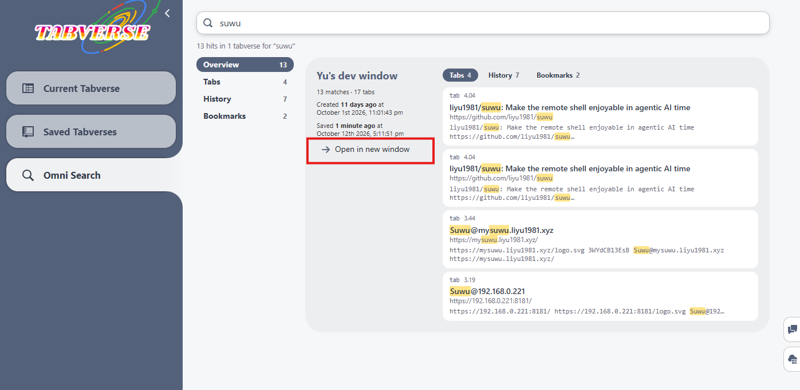

# Omni search

One search covers everything a tabverse holds: **tab titles and urls, history
(closed tabs), notes, todos and bookmarks**.

The basic search box over the saved tabverse list is documented in
[Tabverses](../basic-usage/tabverses#search-saved-tabverses). This page is the
full view and the server-backed index.

## Where the search runs

- **Without a server**, the search scans the data stored in this browser.
- **With a server paired**, the search uses the server's full text index, which
  knows every tabverse of the account - including ones this browser has not
  downloaded yet. If the server cannot be reached, the search falls back to the
  local scan automatically.

## Reading the results

Results are catalogued by **tabverse**, not listed as loose records:

- the first tab, **Overview**, ranks tabverses by how many records of any kind
  matched;
- **Tabs**, **History**, **Notes**, **Todos** and **Bookmarks** each rank
  tabverses by how many of that kind matched.

Inside a tabverse the matched records are listed with the terms you typed
highlighted. Opening a result loads the tabverse it belongs to.

## Omni Search

When a server is paired, the left sidebar gets an **Omni Search** entry. It is
the same unified search as a full view: a query box, the kind tabs, and one card
per matched tabverse, each with a button to open that tabverse in a new window.

The server's [console](../server-console) offers the same search to an operator
looking at an account.
