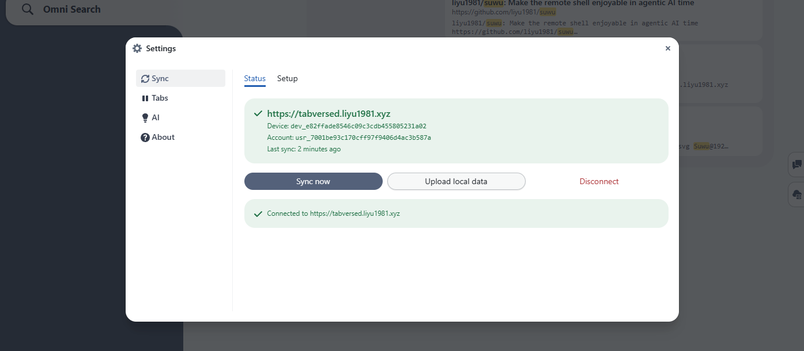
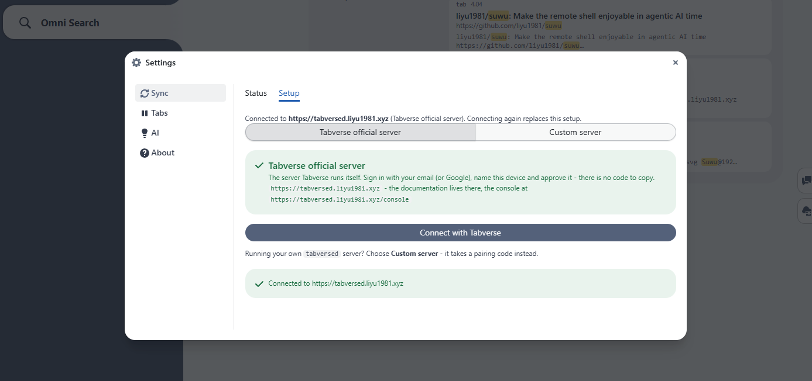

# Sync with a server

Tabverse is local first. On its own it needs no account and no network: every
tabverse, note, todo and bookmark lives in this browser's own database.

If you want the same workspace on more than one browser, you can pair Tabverse
with a **sync server**. The server is `tabversed`, an open source Go program you
run yourself; the extension talks to exactly the address you type, and to
nothing else. See [Self-host a server](../self-host-server) to run one.

## What syncs

- tabverses, with their tabs, tab groups and split views
- notes, todos and bookmarks
- history (closed tabs)
- the periodic session snapshots older clients wrote (pruned by retention)

## Pairing a device

The sync settings are in **Settings ▸ Sync** (the **Sync** button at the bottom
left). Once a device is paired, the **Status** tab shows the server, the device
and account ids, and when it last synced, with **Sync now**, **Upload local
data** and **Disconnect**:

The **Setup** tab has the two ways to pair.

**Tabverse official server** - the server the project runs. Sign in with your
email (or Google), name the device and approve it; there is no code to copy.

**Custom server** - a `tabversed` you run yourself. Paste its URL and a
single-use pairing code minted in its console (see
[Self-host a server](../self-host-server)).

Each browser pairs once and receives its own device token, which is the only
credential that reaches the account's data. A device can be unpaired from the
server at any time, and **Disconnect** stops the sync on this side.

## Accounts and the console

A device is *paired*; it is not a login. The server also has a small web console,
where you sign in to see and manage the account:

- the paired devices and their tokens, and revoke a lost one
- the stored data - tabverses, records and search - read only
- (operators) the directory of accounts on the server

Sign-in is a single-use link emailed to you, or GitHub / Google if the operator
of that server configured it. There is no master token or shared password: the
person who runs the server is an ordinary account, and everything done in the
console is recorded. See the [Server Console](../server-console).

## Privacy

The server stores what it must to index and serve your data, in plain text on
its disk, so that server-side search can find it; put it on an encrypted volume
for more. Session snapshots are pruned after 14 days by default
(`TABVERSED_RETENTION_DAYS`, `0` keeps them forever). Disconnecting a device
stops the sync, and the local copy is untouched.

Nothing is ever sent to a third party, and nothing leaves for any host but the
server address you entered. The full posture is in the
[privacy policy](/privacy).

## Next

- [Self-host a server](../self-host-server) - run `tabversed` for yourself.
- [Server Console](../server-console) - the account and data surface of a
  deployment.
