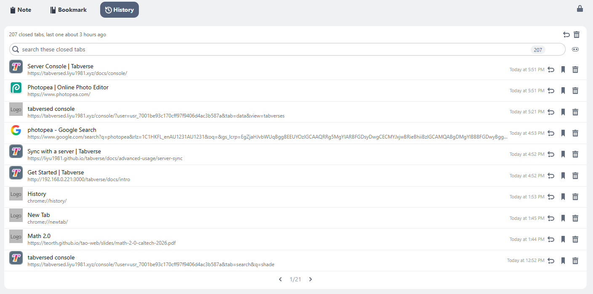

# History tool

The History tool is the list of tabs **closed from this tabverse** - one row per
url, most recent first. It is a convenience for bringing something back, not a
copy of Chrome's own history. A tabverse keeps up to 999 closed tabs.

## Bring one back

- Click a row's **title**, or its **undo** button, to reopen it as a new tab in
  this window.
- The **undo** button in the card header reopens the last closed tab.
- **Save as Bookmark** turns a closed tab into a [bookmark](./bookmark) and
  removes it from the history, so it lives in one place and not two.
- **Forget It** removes the row without reopening it.
- **Clear The Whole History** (the trash button in the header) asks for
  confirmation, then empties the list.

## Search and group

- The box at the top searches titles and urls; it shows how many of how many
  match, and **Esc** clears it (a second **Esc** leaves the box).
- The **Group by site** switch draws the same list under one header per site,
  newest site first. The grouped view is not paged; the flat list pages ten rows
  at a time.
