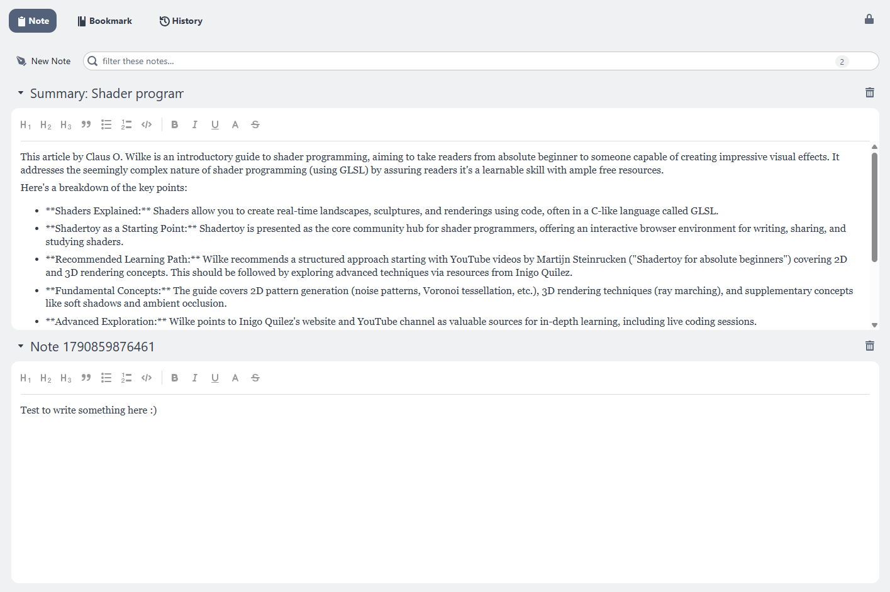

# Note tool

The Note tool holds rich-text notes attached to the tabverse. A note is a small
document with a name; it is saved with the tabverse, restored with it, and -
when you pair a server - synced like everything else.

## Create and edit

- **New Note** adds a note named `Note <timestamp>` and opens its editor.
- Click the **name** to rename the note.
- The editor is rich text: headings **H1-H3**, **bold**, *italic*,
  <u>underline</u>, `monospace`, ~~strikethrough~~, blockquote, bullet and
  numbered lists, and code blocks.
- The **caret** on the left collapses a note (collapsing saves it); the
  **trash** button deletes it.

Notes are saved when you leave the editor or collapse the note.

## Filter

The box above the list filters notes by their name and their text, and shows how
many of how many match.

## Summarize a tab into a note

Where Chrome ships its built-in model, the lightbulb on a live tab row offers
**New note with AI summary** - the page's article is summarized into a new note
in this tabverse - and **Append to current note with AI summary**, which
proposes the same summary in the note you are editing, for you to review before
it is written. The summary is built from the page's Markdown, so it reads the
article rather than the page's navigation and footers.

See [On-device AI](../advanced-usage/ai) for the page actions (including
**View page content as Markdown** and **Send page content to AI chat**).
