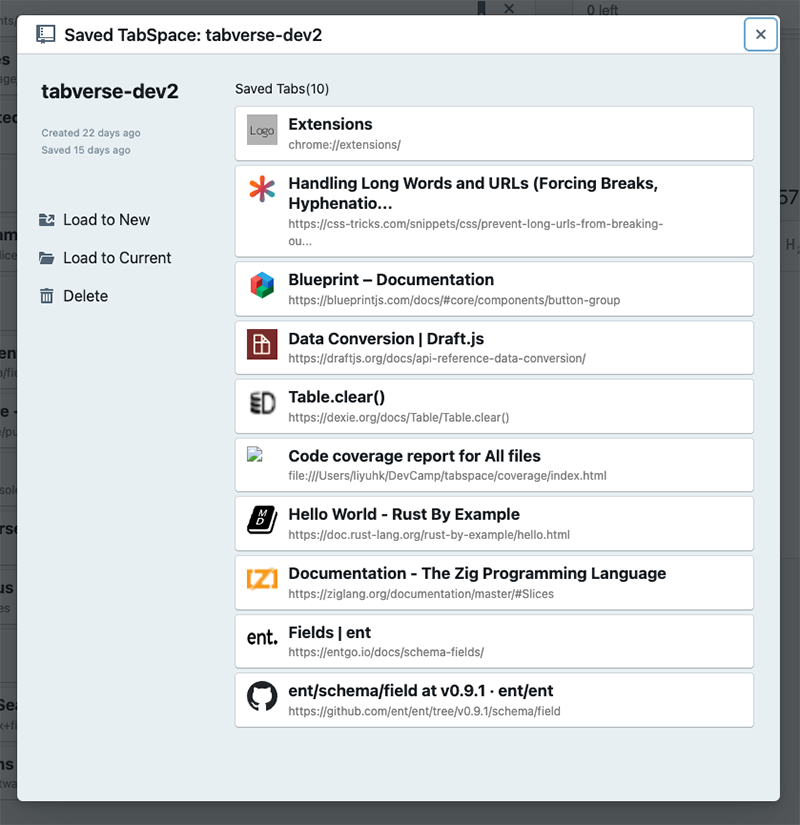

# Tabverses

A tabverse is one Chrome window and its tabs, with a name and a memory. This
page covers creating one, the manager interface, saving and restoring, searching
your saved tabverses, and exporting and importing them as files.

## Create a new tabverse

Click the Tabverse `T` icon in Chrome's toolbar. If the current window is not
already a tabverse, Tabverse opens it as one, in a new tab.

**Create New Tabverse** (top-left) opens a **new Chrome window** with a new
tabverse in it, so you can start something new without disturbing what you are
doing.

A window holds at most one tabverse at a time. If the window already has one,
the manager asks before replacing it, and tells you the current one is already
saved.

## The manager interface

- **Saved tabverses** (left, top) - every tabverse saved in this browser, newest
  first. Click the *last update* / *created* sub-heading to switch the sort.
  Clicking a row opens its [restore dialog](#restore-a-saved-tabverse).
- **This window's tabs** (left, bottom) - the live tabs of the window the
  tabverse is in. The name at the top is editable; hovering a tab shows its
  details and a preview.
- **Tools** (right) - [Todo](./todo), [Note](./note), [Bookmark](./bookmark)
  and [History](./history), attached to this tabverse. You can pin one tool to
  the top and move the rest into the scrolling list below it.

Everything is saved as you work: tab events (open, close, move, pin) and tool
edits are written to this browser's database immediately. There is no "save"
button to remember.

## Save & close

**Save & close** (above the tab list) flushes any pending change and closes the
tabverse's manager tab. The window and its tabs stay open - the tabverse is
simply put down and stays in the saved list, ready to restore.

## Restore a saved tabverse

Click any saved tabverse to open its dialog:

- **Load to New** - opens the tabverse in a new Chrome window, with all its
  saved tabs.
- **Load to Current** - loads it into the current window. This is a **merge**:
  the tabs already open in the window are kept, a saved tab whose url is already
  open is reused rather than reopened, and only the missing tabs are opened.
  Nothing is closed.
- **Switch to Tabverse** - if this tabverse is already open in another window,
  brings that window to the front instead of opening a second copy.
- **Delete** - deletes the saved tabverse and everything attached to it. There
  is no confirmation and no undo.

## Search saved tabverses

The search box above the saved list searches this browser's tabverses - their
names and their contents: tab titles and urls, notes, todos, bookmarks and
history. Results are shown as tabverses, not as loose rows.

This search is **local**: it scans what this browser holds. If you pair with a
server, a second, server-backed search appears in the sidebar and knows every
tabverse on the account - see [Omni search](../advanced-usage/omni-search).

## Export and import

**Export** (the download button next to Save & close) writes the current
tabverse to a `.tabverse` file: the tabverse itself, its tabs and tab groups,
notes, todos, bookmarks and history, as one JSON document. It does not change
the tabverse or close anything.

**Import** (the button beside **New** in the toolbar popup) reads a `.tabverse`
file back as a **new, independent** tabverse:

- every id is reminted, so importing the same file twice - or into a browser
  that already holds the original - never collides;
- the new tabverse is named `Imported: <original name> - <time>`;
- it lands in the saved list; it is not opened.

A `.tabverse` file is portable, so a tabverse can move between browsers,
machines or people by file.
