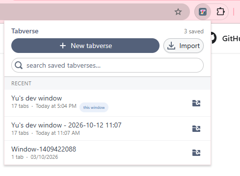
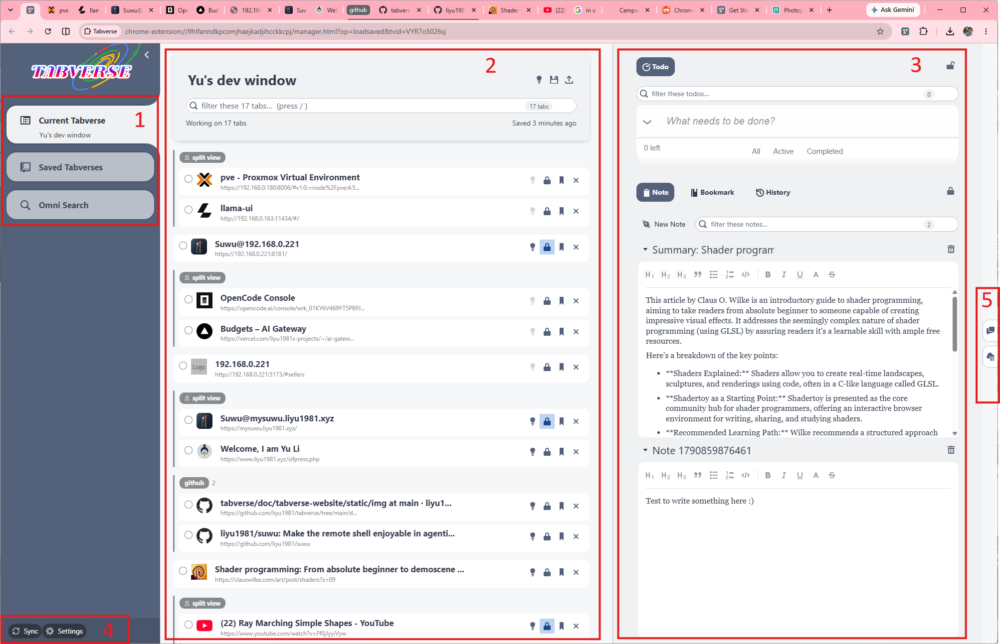
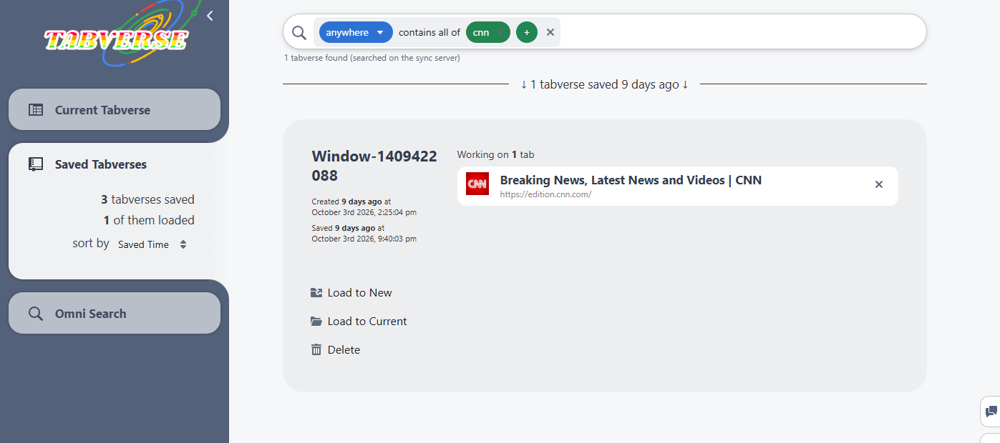

# Tabverses

A tabverse is one Chrome window and its tabs, with a name and a memory. This
page covers creating one, the manager interface, saving and restoring, searching
your saved tabverses, and exporting and importing them as files.

## Create a new tabverse

Click the Tabverse `T` icon in Chrome's toolbar to open the popup, then
**New tabverse**:

- If the current window is not a tabverse yet, it becomes one, in a new tab.
- If it already has one, Tabverse asks first: the current tabverse is already
  saved, and continuing replaces it here - the tabs the window has open become
  part of the new one.

A window holds at most one tabverse at a time.

## The manager interface

- **1 - Current Tabverse**: the sidebar entry for the tabverse of this window
  (its name is below it). The other entries are **Saved Tabverses** and
  **Omni Search**.
- **2 - This window's tabs**: the live tabs the tabverse manages. The name at
  the top is editable; the box filters the list (`/` focuses it); the header
  says how many tabs there are and when the tabverse was last saved. Split views
  are drawn as one block, and each row has its own buttons (pin, suspend,
  bookmark, close). The icons at the top right are the AI name suggestion,
  **Save & close** and **Export**.
- **3 - Tools**: [Todo](./todo), [Note](./note), [Bookmark](./bookmark) and
  [History](./history) for this tabverse. One tool can be pinned to the top; the
  rest move into the scrolling list below it.
- **4 - Sync / Settings**: the bottom-left buttons. **Sync** opens the sync
  settings; **Settings** opens the dialog with Sync, Tabs (tab suspension), AI
  and About.
- **5 - The right rail**: two panels that are about the tooling around a
  tabverse, not about the tabverse itself - **AI history** and the **Server
  console**. Click an icon to open the panel; it pushes the tabverse to the
  left.

Everything is saved as you work: tab events (open, close, move, pin) and tool
edits are written to this browser's database immediately. There is no "save"
button to remember.

## Save & close

**Save & close** (above the tab list) flushes any pending change and closes the
tabverse's manager tab. The window and its tabs stay open - the tabverse is
simply put down and stays in the saved list, ready to restore.

## Restore a saved tabverse

Open **Saved Tabverses** in the sidebar and click a row; its detail opens on the
right:

- **Load to New** - opens the tabverse in a new Chrome window, with all its
  saved tabs.
- **Load to Current** - loads it into the current window. This is a **merge**:
  the tabs already open in the window are kept, a saved tab whose url is already
  open is reused rather than reopened, and only the missing tabs are opened.
  Nothing is closed.
- **Switch to Tabverse** - if this tabverse is already open in another window,
  brings that window to the front instead of opening a second copy.
- **Delete** - deletes the saved tabverse and everything attached to it. There
  is no confirmation and no undo.

## Search saved tabverses

The search box above the saved list searches this browser's tabverses - their
names and their contents: tab titles and urls, notes, todos, bookmarks and
history. Results are shown as tabverses, not as loose rows.

This search is **local**: it scans what this browser holds. If you pair with a
server, a second, server-backed search appears in the sidebar and knows every
tabverse on the account - see [Omni search](../advanced-usage/omni-search).

## Export and import

**Export** (the download button next to Save & close) writes the current
tabverse to a `.tabverse` file: the tabverse itself, its tabs and tab groups,
notes, todos, bookmarks and history, as one JSON document. It does not change
the tabverse or close anything.

**Import** (in the toolbar popup) reads a `.tabverse` file back as a **new,
independent** tabverse:

- every id is reminted, so importing the same file twice - or into a browser
  that already holds the original - never collides;
- the new tabverse is named `Imported: <original name> - <time>`;
- it lands in the saved list; it is not opened.

A `.tabverse` file is portable, so a tabverse can move between browsers,
machines or people by file.
