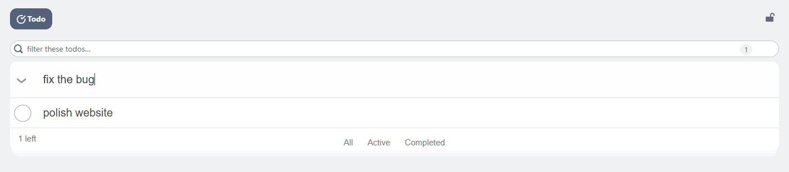

# Todo tool

The Todo tool is a checklist for the current tabverse. It is saved with the
tabverse, restored with it, and - when you pair a server - synced like
everything else.

## Add and complete

- **Add** - type in the box at the top ("What needs to be done?") and press
  **Enter**.
- **Complete** - tick the checkbox on the left; completed todos drop to the
  bottom of the list.
- **Edit** - double-click a todo, or focus it and press **Enter**, then type.
  Press **Enter** or click away to save.
- **Delete** - the `×` at the right of the row.

## Filter and clear

- The box above the card filters the list as you type, and shows how many of how
  many match.
- **All / Active / Completed** under the list switches which todos are shown.
  The count on the left is how many are still open.
- **Clear completed** removes every completed todo at once.
