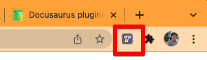
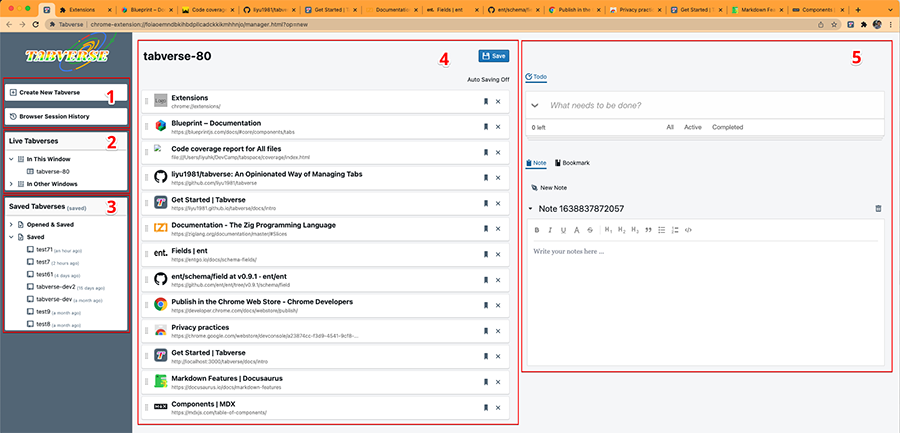

# Get Started

## What is a **Tabverse**?

When we are working on something, we usually open a chrome window and a lot of
tabs in it. Those tabs are all related the same topic. They are searches,
results, documents, online tools. We then define a **Tabverse** as the group of this
window and all its tabs, plus a managing application who can helps us to
remember tabs and making notes etc. It will help us on those tedious book
keeping work so that when we want a break from our work (or have finished our
work), we can simply close the window, but with Tabverse's help, all data is
reserved.

## Installation

The Chrome Web Store listing is still under review, so that button is disabled
on this site for now. In the meantime you can install Tabverse manually:
download the latest `.crx` from the
[GitHub releases](https://github.com/liyu1981/tabverse/releases), then follow the
[manual installation guide](https://www.cnet.com/tech/services-and-software/how-to-install-chrome-extensions-manually/)
to load it into Chrome.

## What Tabverse does

- **Tabverses.** One Chrome window is one workspace; save it and restore it
  later, with all its tabs. See [Restore a saved Tabverse](./restore.md).
- **Notes, todos and bookmarks** attached to a tabverse.
- **History** of the tabs closed from that tabverse.
- **On-device AI** that can summarize a tab into a note, or suggest a name for a
  tab collection ([details](./ai.md)).
- **One search** across tabs, history, notes, todos and bookmarks
  ([details](./search.md)).
- **Optional server sync**, so the same workspace is on every browser you use
  ([details](./server-sync.md)).

## Get Started after Installation

After installing, Tabverse can be started by clicking the `T` icon in chrome
extension's menu.

By clicking Tabverse icon, we will then create our first Tabverse in a new tab
in current window. Below is an example of Tabverse.

Let's walk through **Tabverse** UI section by section:

- **Section 1** is for `Create New Tabverse`.
  `Create New Tabverse` will open a new chrome window as well as a new tabverse,
  so you can start work on something new there.

- **Section 2** is showing the Tabverse of the current window. Each Tabverse
  manages the tabs of the window it was created in; Tabverses in other windows
  are managed from those windows.

- **Section 3** is showing all saved Tabverses in local storage. It is sorted by
  either last update time, or created time (clicking the sub string in header to
  switch). Clicking one saved Tabverse entry will open a dialog showing its
  details as well as offering [restore options](/docs/restore).

- **Section 4** is showing the current tabs in current Window, which is managing
  by our Tabverse. You can set the name for it, choose to save it, and hovering
  on each tab entry for checking its detail and preview.

- **Section 5** are several utils to help us to do our work. They are Todos,
  Notes and Bookmarks. If you have saved your Tabverse, all your Todos, Notes
  and Bookmarks will be saved and associated to your Tabverse. Later if you
  restore one of your saved Tabverse, all associated Todos, Notes and Bookmarks
  will be restored too.
