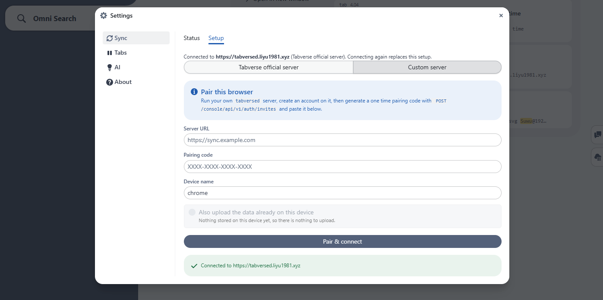

# Self-host a server

Tabverse is local first; a server is optional. If you want the same tabverses on
more than one browser, run **`tabversed`** yourself. It is a single Go program
with an SQLite data directory - no external database, no cloud dependency - and
it is the only server the extension will talk to.

This page is the practical path. The
[server README](https://github.com/liyu1981/tabverse/blob/main/server/README.md)
is the complete reference: every setting, the protocol semantics, the account
model and the API.

## What you need

- A machine that can run a Go binary - Linux `amd64` or `arm64` (the build is
  CGO-free), or build from source anywhere Go runs.
- A way for the browser to reach it: an address on your LAN
  (`http://192.168.0.221:8223`) or a public HTTPS origin
  (`https://tabs.example.com`).
- Optionally, an SMTP host, so sign-in links can be emailed. Without one the
  link is printed to the server log, which is fine for a LAN.

## Quick start (from source)

```sh
pnpm install
pnpm run ui:build        # build the console, embedded into the binary
pnpm run server:dev      # listens on 0.0.0.0:8223, db ./server/data/tabversed.db
```

Then:

1. Open `http://localhost:8223/console` and **sign in** with your address. The
   first time, that registers the account; the link is emailed if SMTP is
   configured, and printed to the server log otherwise.
2. In the console's **Pair Code** tab, mint a single-use code.
3. In the extension, open **Settings ▸ Sync ▸ Setup ▸ Custom server** and pair
   with the server URL (the address *the browser* can reach it at) and that
   code:

   

The extension may talk to any `http`/`https` server (`adr/0010`); a device token
is a bearer credential, so prefer `https://` or a trusted network.

## Run it as a service

```sh
pnpm run server:build                 # -> server/bin/tabversed (builds the console first)
install -Dm755 server/bin/tabversed ~/.local/bin/tabversed
tabversed config --dir ~/.tabversed   # write a .env where the service will look
tabversed service install             # a systemd *user* unit, no root
loginctl enable-linger $USER          # optional: keep running when logged out
tabversed service start
tabversed service logs                # follows the journal
```

`tabversed service` manages a `systemctl --user` unit at
`~/.config/systemd/user/tabversed.service`, running `~/.local/bin/tabversed
serve` with its working directory at `~/.tabversed` (where it reads `.env` from,
and where the database lands by default). Replacing that binary is the upgrade.

A Docker image is built by `pnpm run server:docker`:

```sh
docker run -p 8223:8223 -v tvdata:/data tabversed
```

## Configuration

Settings come from the environment or from a `.env` file next to the binary
(the environment wins). `tabversed config` writes a filled-in template. The ones
worth setting on a real deployment:

| Variable | Default | Meaning |
| --- | --- | --- |
| `TABVERSED_ADDR` | `0.0.0.0:8223` | listen address; use `127.0.0.1:8223` to stay local |
| `TABVERSED_PUBLIC_URL` | _(unset)_ | the origin the deployment is reached at; used for sign-in links and social callbacks |
| `TABVERSED_ADMIN_EMAIL` | _(unset)_ | whose **first registration becomes the operator** |
| `TABVERSED_REGISTRATION_REQUIRES_INVITE` | `false` | make registration invite-only: invite addresses from the console's **Admin** page (`/console/admin`). The admin address is always exempt |
| `TABVERSED_EMAIL_REGISTRATION` | `true` (official build: `false`) | the passwordless email path; `0` means social logins only |
| `TABVERSED_SMTP_HOST` / `_FROM` | _(none)_ | where sign-in links are sent |
| `TABVERSED_RESEND_API_KEY` / `_FROM` | _(none)_ | send through [Resend](https://resend.com) (an HTTP email API) instead; preferred over SMTP when set |
| `TABVERSED_SECURE_COOKIES` | `true` | turn off only for plain http on a trusted LAN |
| `TABVERSED_DB` | `data/tabversed.db` | central SQLite file (accounts, devices, tokens) |
| `TABVERSED_USERS_DIR` | `users/` beside it | per-account content databases (`adr/0027`) |
| `TABVERSED_MAX_OPEN_USER_DBS` | `64` | cap on simultaneously open content files (the file-descriptor budget) |
| `TABVERSED_RETENTION_DAYS` | `14` | prune old `session` snapshots (`0` keeps forever) |
| `TABVERSED_FRAME_ANCESTORS` | `chrome-extension:` | who may embed the console in an iframe; the default admits browser extensions only |

The full table - plus `TABVERSED_MAX_RECORD_BYTES`,
`TABVERSED_SYNC_BATCH_LIMIT`, `TABVERSED_SEARCH_LIMIT`,
`TABVERSED_WS_ORIGINS`, the session TTLs and the social provider keys - is in
the [server README](https://github.com/liyu1981/tabverse/blob/main/server/README.md).

## Who may register

By default anybody who can reach the server can create an account, but signing
in and creating the account are **two steps** (ADR 0029). A social provider, or
the emailed sign-in link, proves who the person is; a **Create your account**
page then asks for the email (required) and their agreement to the user
agreement. Nothing creates an account silently, so a session that outlives its
account - a deleted one, or a database restored from before it existed - is sent
back to that page instead of recreating a user.

Two settings gate registration:

- **`TABVERSED_REGISTRATION_REQUIRES_INVITE=1`** makes it invite-only: the
  register page then requires an invitation code. Invite addresses from the
  console's **Admin ▸ Registration invites** section. Every invitation carries a
  code and the message names it. Nothing sends mail on its own: opening an
  invitation shows the drafted message to copy, and an explicit **Send with
  Resend** button sends that same message. A person with no code can **request
  an invitation** on the register page: that creates a pending request the
  operator sees in the console, and the requester's next sign-in shows a waiting
  notice instead of the console. Approving a request mints the invitation and
  drops the request; the person then registers with the code like anybody else -
  the code is never skipped. The admin address is exempt from the code, so the
  operator can always register first.
- **`TABVERSED_EMAIL_REGISTRATION=0`** turns the passwordless email path off and
  leaves social logins only. The official build defaults to this.

## TLS

Serve it behind a reverse proxy (Caddy, nginx, or a tunnel) that terminates
TLS, and set `TABVERSED_PUBLIC_URL` to the public origin. The console sets
`Secure` cookies and HSTS on that basis; `TABVERSED_REQUIRE_HTTPS=true` makes
the server refuse to start when the console is served over plain http on a
non-loopback address. Plain http on a LAN works (set
`TABVERSED_SECURE_COOKIES=false`), but the device token is then readable by
anything on that network.

## Becoming the operator

Set `TABVERSED_ADMIN_EMAIL` to your address **before** you register, and the
account that matches becomes the operator on first registration - no token, no
code. If the address already has an account, the next start promotes it. Once an
operator exists the variable grants nothing, so leaving it set is harmless.

The operator gets a separate **Admin** page at `/console/admin` (a button in the
header), with the accounts, *Impersonate*, role changes, and the registration
invites. See the [Server Console](./server-console).

## Next

- [Server Console](./server-console) - what the console offers once it is
  running.
- [Sync with a server](./advanced-usage/server-sync) - the extension side of
  pairing.
