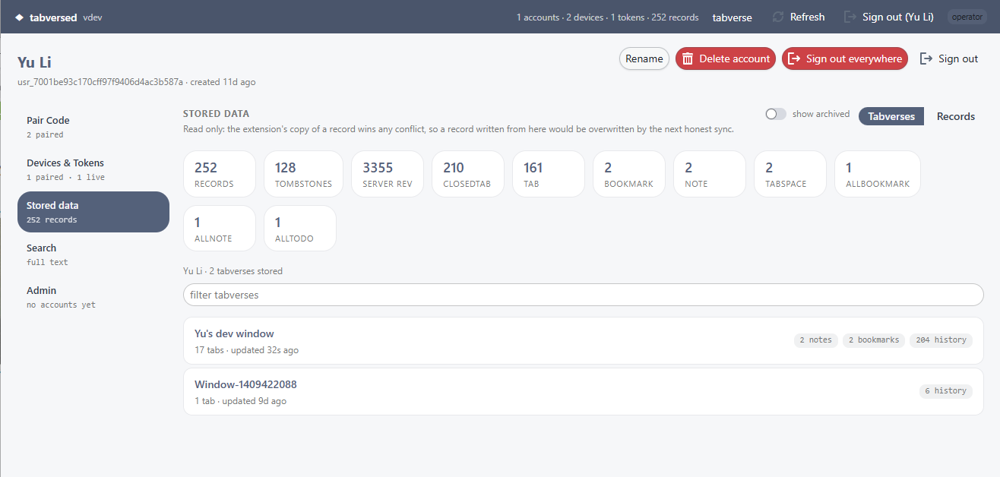

# Server Console Usage

Every `tabversed` server serves a small web console at `/console`. It is the web
UI of the deployment: the [sync server](./advanced-usage/server-sync)'s account
and data surface. It is also where you mint the pairing code a browser needs.

## For a signed-in account

The rail on the left is the account, section by section:

- **Pair Code** - mint a single-use code to pair another browser, with a
  lifetime you choose. Copy it together with the server URL into the extension's
  sync dialog.
- **Devices & Tokens** - see every paired device and when it was last seen, and
  revoke a lost one. Revoking a token cuts that device off; it has to pair
  again.
- **Stored data** - the account's tabverses and raw records, read only. The
  counters at the top count records by entity; clicking a tabverse opens the same
  read-only view the extension draws. A record written from the console would
  lose the next sync conflict, so it does not offer to write one.
- **Search** - full text search over the account's own records.

An operator also gets a separate **Admin** page at `/console/admin`, reached
from a button in the header next to *tabverse* (see below).

Sign-in is a single-use link emailed to you, or GitHub / Google if the operator
enabled it. "Sign out everywhere" ends every browser session on the account;
paired devices keep syncing, because their tokens are a different credential.

## For an operator

The account matching the server's `TABVERSED_ADMIN_EMAIL` is the operator.
Operators see the directory of accounts and can, for any account:

- rename it, change its role, or delete it (which removes its data - there is no
  undo);
- mint a pairing code, revoke a device or token, and archive a dead one;
- impersonate it: a read-only, time-limited, logged view for answering support
  questions. It cannot change anything, and every session started this way is
  recorded in the audit log.

**Archiving is not deleting.** Archiving a token, a device, or the records a
device wrote only hides them from the console's default views; the rows stay
stored and keep syncing to the user's own devices, and it is reversible. The
only real removal is deleting the account.

## Next

- [Self-host a server](./self-host-server) - run the server this console
  belongs to.
